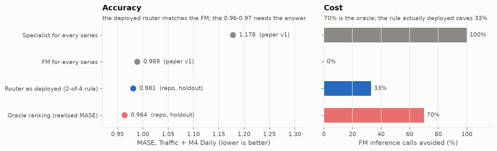

# Block 1: tech watch, checked at the source

The plan cites three resources and one reference paper. Each claim was read at its source (PDFs, model cards,
the paper's code repository, and the GIFT-Eval result files recomputed from
`github.com/SalesforceAIResearch/gift-eval`). Checked on 2026-10-30. Two claims hold as written, three hold
only in part.

| Claim in the plan | What the source says | Verdict |
|---|---|---|
| IBM's three forecasters emit quantiles natively | True. FlowState r1.1 (9 quantiles), TTM-r3 (new multi-quantile head), PatchTST-FM r1 (99 quantiles). Only TTM is new to quantiles. | holds |
| The GIFT-Eval point-forecast leader has only 18.5M parameters | On 12 April 2026, FlowState r1.1 (18.5M) was #1 by MASE **only with the filters "zero-shot" and "replication code"** (0.7015 vs TimesFM-2.5 0.7050). Unfiltered it was #13. On 30 Oct 2026 it is #13 even in that filter; unfiltered #77. | partly, and outdated |
| arXiv:2605.24381: the Complexity Router gives higher accuracy at a much lower inference cost than a universal TSFM | The headline (MASE 0.970, 70% cost cut) ranks series by their **realised test MASE**: an oracle. The repo's holdout gives the deployed 2-of-4 rule **0.981 vs 0.989 for the FM alone, with 33% fewer FM calls**. The cost ratio of an FM call (1000x) is assumed, not measured. No statistical test. | partly |
| The paper's "physically constrained" regime is where specialists win | Its energy regime is ETTh1: 7 series of transformer **oil temperature**. Nothing in the paper is electricity load. | does not transfer to our case |
| The Substack article (May 2026) classifies TSFM limits as workaround-able, not, or open | Published 24 April 2026. Two groups only: "true challenges" (loss function and context length: workarounds; high-frequency bias: no fix; scaling laws and covariates: open) and "not really problems" (interpretability, data leakage). | partly |
| Hyndman & Koehler (2006) define the seasonal MASE | The paper scales by the one-step naive (lag 1). The lag-m version is FPP3 section 5.8. | cite FPP3 for m = 24 |

## What this changes for blocks 2 and 3

- **Contamination of our French series: no documented overlap.** The Chronos-2 training list (arXiv 2510.15821,
  Table 6) has no ENTSO-E or OPSD data. Chronos-Bolt's corpus is **not itemised**. If it reuses the Chronos corpus,
  it contains the Kaggle "Spanish Energy and Weather" set (Spanish national load 2015-2018, built from ENTSO-E).
  That set comes from the same provider and covers the same years, but it is another country. The fev-bench `entsoe_1H`
  task uses OPSD 2020-10-06 for AT, BE, DE, HU, LU and NL, as evaluation data only. Our block 3 uses some of those
  countries, so Chronos-2 results there are not "never seen by the authors' benchmarks". Reading kept in block 2:
  Bolt's zero-shot score could be slightly optimistic; nothing says it is.
- **Licences**: chronos-bolt-small, chronos-bolt-base and chronos-2 are Apache-2.0. TTM-r3 is CC-BY-NC-SA-4.0,
  so a freelance deliverable cannot ship it.
- **The router of block 3 is evaluated out of sample from the start**, with its thresholds learned on other
  series than those it is scored on. That is the step the paper's headline skips.
- **The paper's router features** are spectral entropy >= 0.24, coefficient of variation >= 0.22,
  seasonal autocorrelation >= 0.72 or < 0.50, and trend R^2 < 0.05. A series goes to the FM when at least 2 of the
  4 hold. They were tuned on Traffic and M4 Daily. Block 3 measures them on load series instead of copying them.
- **MASE scale**: seasonal naive with m = 24, as the plan asks, per FPP3 section 5.8.

## Sources

- tsfm.ai, "IBM's March 2026 time-series refresh", 12 April 2026 (updated 6 Oct 2026):
  https://tsfm.ai/blog/ibm-march-2026-time-series-refresh. Model cards:
  https://huggingface.co/ibm-granite/granite-timeseries-flowstate-r1, https://huggingface.co/ibm-research/ttm-r3,
  https://huggingface.co/ibm-granite/granite-timeseries-patchtst-fm-r1
- Soni, Das, Guduguntla, "Assessing the operational viability of foundation models for time series forecasting",
  arXiv:2605.24381 v1, 23 May 2026. Code and holdout numbers: https://github.com/kavin-soni/TimeSeries-ZeroShot-Eval
  (README, `results/routing_analysis_holdout.py`)
- Kafritsas, "Time series foundation models: a deep dive into strengths and limitations", AI Horizon Forecast,
  24 April 2026: https://aihorizonforecast.substack.com/p/time-series-foundation-models-a-deep
- Ansari et al., "Chronos", arXiv:2403.07815 (App. B, Table 3); Chronos-2 technical report, arXiv:2510.15821
  (App. A, Table 6); https://huggingface.co/amazon/chronos-bolt-base; https://huggingface.co/datasets/autogluon/fev_datasets
- Hyndman & Koehler, "Another look at measures of forecast accuracy", IJF 22(4), 2006 (preprint:
  https://robjhyndman.com/papers/mase.pdf); Hyndman & Athanasopoulos, FPP3 section 5.8: https://otexts.com/fpp3/accuracy.html
