# Block 2: rolling-origin backtest, zero-shot TSFM vs refitted statistical models

French national hourly load (ENTSO-E via OPSD), 24-hour horizon, one origin per day. The test year 2019 has 365
origins, plus a lockdown stress window. Baselines are refitted at every origin; the TSFMs stay zero-shot. The
protocol ([`configs/protocol.yaml`](../configs/protocol.yaml)) was committed before any forecast. One deviation
was added after the first scores and is labelled everywhere.

## The answer in one sentence

> **On French hourly load in 2019, Chronos-Bolt base beats AutoETS at every horizon step and on every ordinary
> day type: MASE ratio 0.24 [0.20, 0.27], or 0.40 [0.35, 0.45] against an ETS with its seasonality forced, and
> its 90% coverage is 0.86. Its "90%" interval is, however, its 80% one by construction. It under-covers on
> h 13-18 (0.79). On the 11 public holidays it is no better than the seasonal ETS (ratio 1.12, CI 0.85-1.55), and
> its interval covers 37% of the hours: zero-shot, it does not know the calendar.**

**Told the calendar, it does (exploratory, not pre-registered).** Given a holiday flag and a bridge-day flag as
known covariates, Chronos-2's error on holidays halves (ratio 0.52 [0.39, 0.67]) and its coverage there goes from
0.35 to 0.77 [0.64, 0.89]. Over the year its 90% coverage becomes 0.899. "Zero-shot" does not have to mean
"univariate". See section 9.

The same sentence holds for Chronos-2, with smaller ratios (0.21 against AutoETS) and a real 90% interval (0.86,
under-covered at 80%: 0.76). Against MSTL, the strongest specialist here, the gap shrinks to 0.85 [0.80, 0.91]
for Bolt base and 0.76 [0.73, 0.82] for Chronos-2. With 6 origins, as in the plan, that comparison flips sign in
24% of random draws.

## Data and protocol

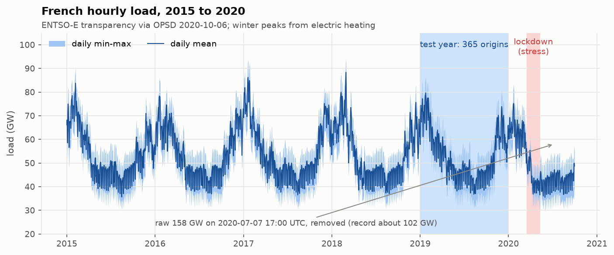

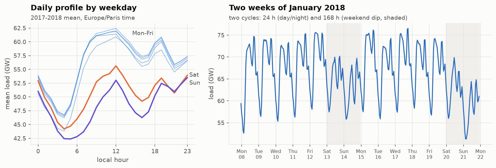

- **Data defects** found before modelling: one hour at 158 GW (2020-07-07 17:00 UTC, against a national record
  of about 102 GW), and 9 gaps of 1 to 13 hours. Values outside [20, 110] GW are set to missing. Gaps are filled
  for model inputs only (linear up to 3 h, otherwise the same hour one week earlier). **An imputed hour is never
  scored.**

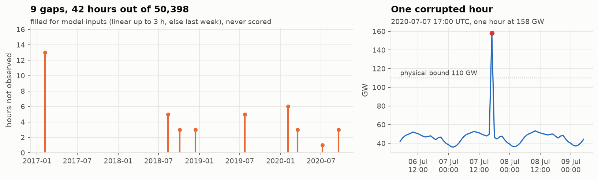

- **Two naives, not one.** The plan's SeasonalNaive(24) forecasts Monday with Sunday. I expected it to be a
  strawman, but measurement contradicts that: it beats the weekly naive on 5 weekdays out of 7. Both are kept.

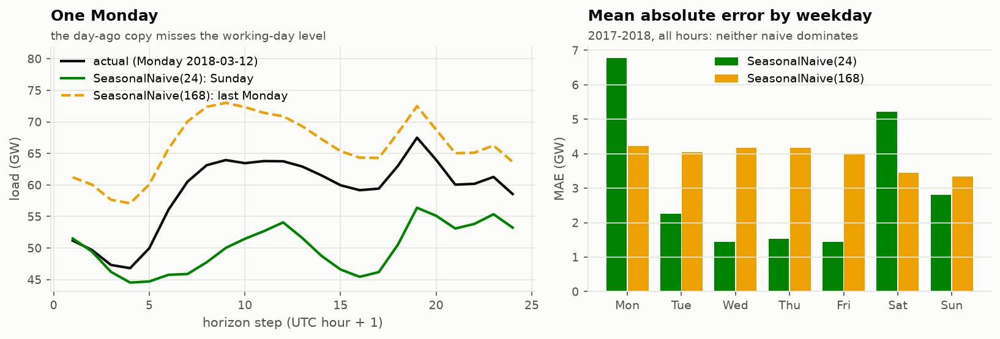

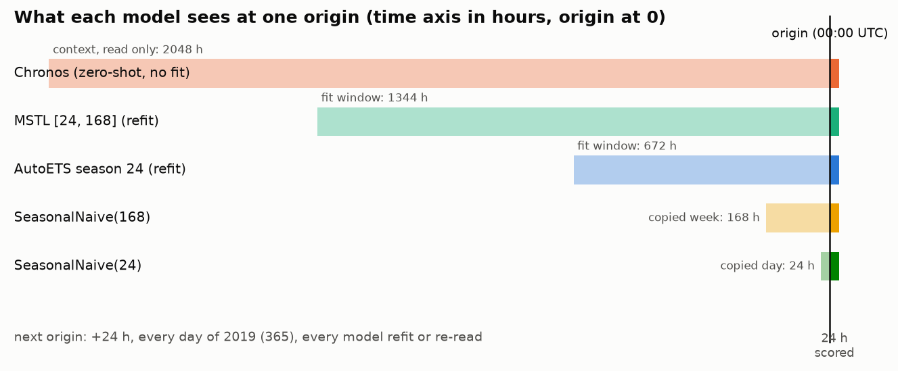

| Model | Fit | Window | Intervals |
|---|---|---|---|
| SeasonalNaive(24), SeasonalNaive(168) | none | last day / last week | residual-based (statsforecast) |
| AutoETS season 24 | refit at each origin, AICc selection | 672 h | model-based |
| ETS(Z,Z,A) (**deviation**) | refit, additive seasonality forced | 672 h | model-based |
| MSTL [24, 168] + AutoETS(ZZN) trend | refit at each origin | 1344 h | model-based |
| Chronos-Bolt small / base | zero-shot | context 2048 h | quantiles 0.1-0.9 only |
| Chronos-2 | zero-shot, `cross_learning=False` | context 2048 h | quantiles 0.01-0.99 |
| `+ conformal` | the model's median, intervals from its own errors at the same step over the previous 56 origins | | split conformal |

## Results, test year 2019 (365 origins)

`uv run w25 backtest` prints this table (the numbers are identical on two runs: forecasts are bit-identical on
the same GPU, and CPU vs GPU differ by at most 0.016 MW).

| model | MASE | sMAPE* | WAPE | cov80 | cov90 | width90** | Winkler90 | SQL | crossing |
|:--|--:|--:|--:|--:|--:|--:|--:|--:|--:|
| SeasonalNaive(24) | 1.001 | 0.030 | 0.059 | 0.824 | 0.879 | 0.293 | 7.08 | 0.429 | 0 |
| SeasonalNaive(168) | 1.084 | 0.030 | 0.061 | 0.854 | 0.915 | 0.330 | 6.92 | 0.448 | 0 |
| AutoETS | 1.715 | 0.053 | 0.102 | 0.772 | 0.899 | 0.450 | 8.74 | 0.669 | 0 |
| AutoETS + conformal | 1.715 | 0.053 | 0.102 | 0.806 | 0.908 | 0.337 | 6.34 | 0.609 | 0 |
| ETS(Z,Z,A), deviation | 1.010 | 0.030 | 0.061 | 0.652 | 0.736 | 0.176 | 6.96 | 0.410 | 0 |
| MSTL | 0.479 | 0.014 | 0.028 | 0.689 | 0.779 | 0.090 | 3.49 | 0.195 | 0 |
| Chronos-Bolt small | 0.435 | 0.013 | 0.026 | 0.859 | 0.859 | 0.088 | 2.79 | 0.173 | 0 |
| Chronos-Bolt base | 0.406 | 0.012 | 0.024 | 0.858 | 0.858 | 0.082 | 2.65 | 0.162 | 0 |
| Bolt base + conformal | 0.406 | 0.012 | 0.024 | 0.795 | **0.902** | 0.108 | 2.72 | 0.163 | 0 |
| Chronos-2 | **0.365** | 0.010 | 0.021 | 0.761 | 0.862 | 0.076 | **2.37** | **0.146** | 0.004 |

\* utilsforecast's sMAPE, |e| / (|y| + |f|): half the textbook value. \*\* in % of the load, as a fraction.
MASE: seasonal-naive scale (m = 24) over the whole history up to the origin. SQL: scaled quantile loss averaged
over 0.1-0.9. Winkler90: interval score divided by the same scale. crossing: share of hours with two adjacent
quantiles in the wrong order.

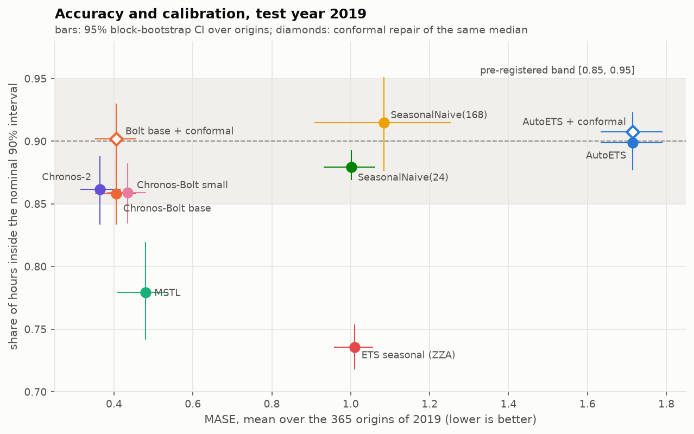

### Pre-registered verdict, as written

| challenger vs AutoETS | MASE ratio [95% CI] | cov90 [95% CI] | verdict |
|---|---|---|---|
| MSTL | 0.279 [0.231, 0.323] | 0.779 [0.742, 0.819] | WINS ON POINTS ONLY |
| Chronos-Bolt small | 0.254 [0.218, 0.291] | 0.859 [0.834, 0.882] | WINS |
| Chronos-Bolt base | 0.237 [0.199, 0.274] | 0.858 [0.833, 0.884] | WINS |
| Bolt base + conformal | 0.237 [0.199, 0.274] | 0.902 [0.873, 0.930] | WINS |
| Chronos-2 | 0.213 [0.178, 0.250] | 0.862 [0.834, 0.888] | WINS |

Against the deviation reference ETS(Z,Z,A), the ratios are 0.40 for Bolt base and 0.36 for Chronos-2, with the same
verdicts. Against MSTL: 0.85 and 0.76, both WINS. Full table, by regime: [`results/verdicts_by_regime.csv`](../results/verdicts_by_regime.csv).

## How to read these numbers

**1. The reference forecasts a flat line (deviation).** statsforecast's AutoETS chooses its model by AICc, which
is a one-step-ahead likelihood. On smooth hourly data, the level-only model ETS(A,N,N) fits the next hour best,
so it wins at 572 of the 608 origins and forecasts 24 times the last observed value. "The TSFM beats AutoETS by a
factor 4" is therefore true but says little. Forcing the seasonality gives a reference at the level of the daily
naive (1.010 vs 1.001). Even then the TSFM wins by a factor 2.5. MSTL, the specialist that has both cycles, is the
real contender.

**2. A flat line can be "perfectly calibrated".** AutoETS covers 0.899 of hours with its 90% interval, almost
exactly nominal, because the interval is 45% of the load wide. Coverage alone rewards a useless interval; the
Winkler score (8.74, the worst of the table) is what says so.

**3. Bolt's 90% interval is its 80% interval.** Chronos-Bolt was trained on the quantiles 0.1 to 0.9. Asked for
0.05 and 0.95, it returns its 0.1 and 0.9 (within the envelope of the 9 trained quantiles when they cross; tested
on the real weights in `tests/test_chronos_models.py`). Hence cov80 = cov90 = 0.858. It lands in the pre-registered
band [0.85, 0.95] **because its 80% interval over-covers**, and the CI of that coverage (0.833-0.884) crosses the
lower edge of the band. The rule says WINS; I would not sign a 90% interval on that basis.
The conformal repair, which keeps the median and rebuilds the intervals from the model's own past errors at the
same horizon step, gives 0.902. Chronos-2 has a real 90% interval (0.862) but under-covers at 80% (0.761).

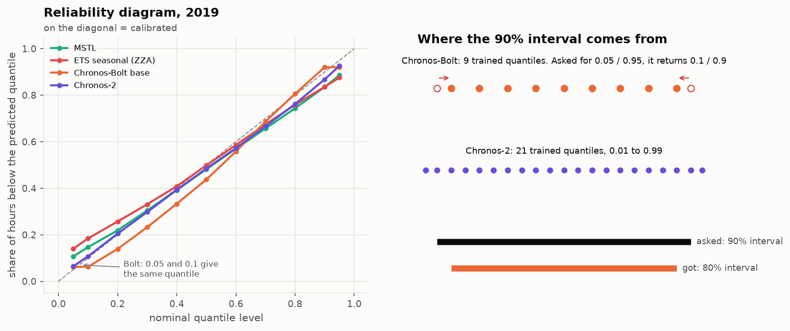

**4. By horizon: point accuracy everywhere, calibration not everywhere.** The TSFMs read the last observed hour,
yet at h = 1 Bolt base's error equals MSTL's (ratio 1.00) and Chronos-2's is 0.77 of it: on the first
hours of a smooth series, every model that reads the last hour does well, and the gap opens later (h 7-12). Their coverage drops to 0.79-0.81 on h 13-18, which is
14:00-20:00 in Paris in summer and covers the afternoon and the evening ramp. MSTL's coverage collapses on the
morning ramp (0.58 at h = 7). The conformal repair is computed per step, which is why it flattens that profile.

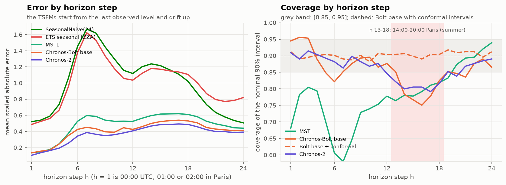

**5. By regime: the calendar is where zero-shot loses.** On the 11 public holidays of 2019, Bolt base has a MASE of
1.49, four times its ordinary level. That is worse than the daily naive (1.42) and the flat AutoETS (1.06), no
better than the seasonal ETS (ratio 1.12, CI 0.85-1.55), and its 90% interval covers 37% of hours (Chronos-2: 35%,
MSTL: 26%). No model here receives a holiday flag. The specialists do no better, but **a specialist can be given
one, while a zero-shot univariate TSFM cannot be told** (Chronos-2 can be given covariates: section 9). The conformal repair does not fix holidays (0.40): it
calibrates on average over the previous 56 days, not conditionally on a rare regime. Bridge days (n = 2) are not
interpretable and get no verdict.

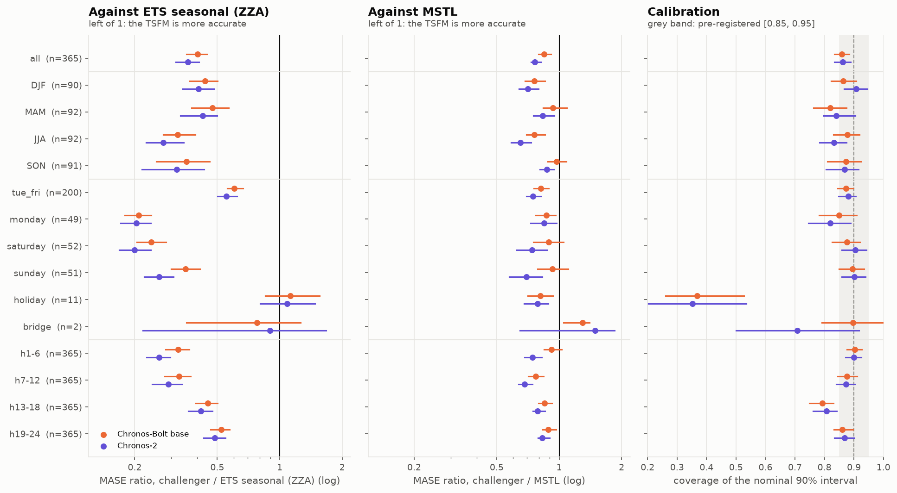

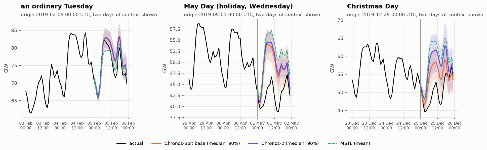

**6. Six origins decide nothing when the contest is close.** Drawing 6 origins out of 365, 2000 times: against the
seasonal ETS, 99.8% of draws give the same ranking as the full year (the gap is a factor 2.5). Against MSTL, 24%
of draws reverse it. The plan's minimum is enough to detect a large gap, not to settle a close one.

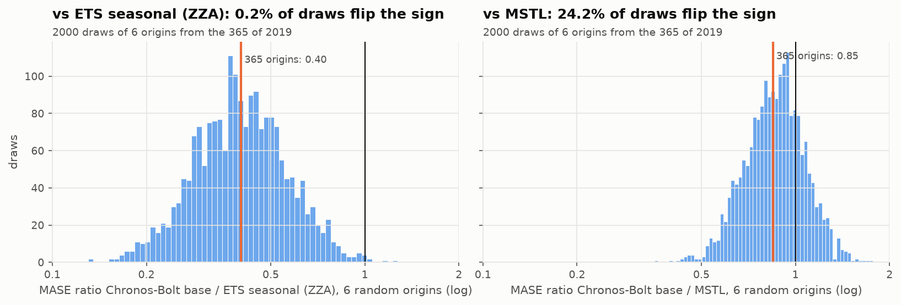

**7. Lockdown (stress, 55 origins).** Every model is hit for about a week after 17 March, then recovers. The
ranking holds: Chronos-2 0.392, Bolt base 0.477, MSTL 0.506, seasonal ETS 0.631, daily naive 0.672. The daily
naive's error falls by a third during the lockdown (MASE 1.00 to 0.67).

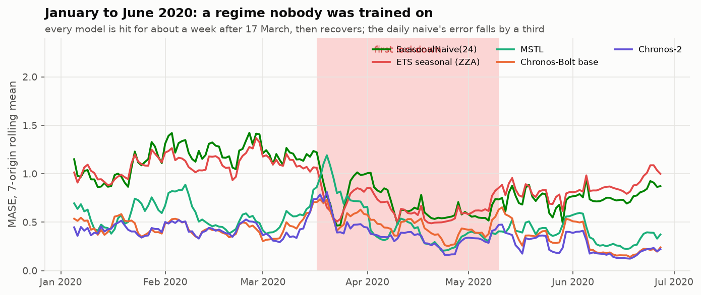

**8. Context length (exploratory, not pre-registered).** With one week of context, Bolt base (0.452) already beats
MSTL fitted on 8 weeks (0.479). Its best context is 1024 h (0.392), not the protocol's 2048 h (0.406). The protocol
is not changed after the fact, since that would select on the test year.

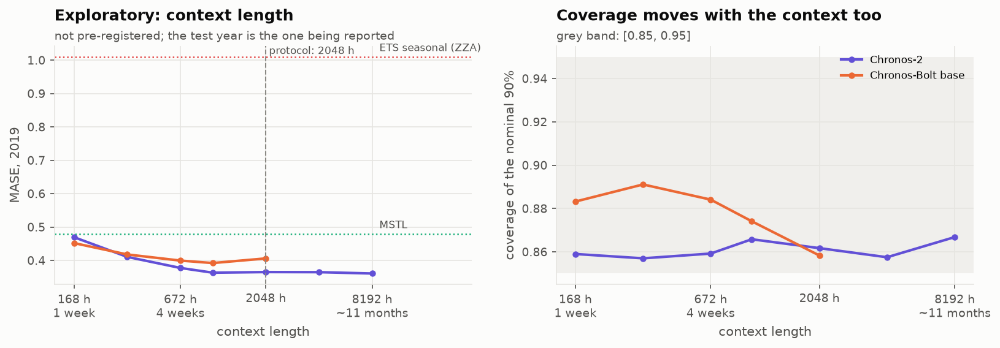

**9. Telling the TSFM the calendar (exploratory, not pre-registered).** Chronos-2 accepts known future
covariates. Public holidays and bridge days are known in advance, so a 0/1 flag for each (from the local date of
every hour) is passed as past and future covariates. Same model, same context; nothing is fine-tuned.

| Chronos-2, test year | MASE | cov80 | cov90 | SQL | holidays: MASE | holidays: cov90 |
|---|---|---|---|---|---|---|
| zero-shot, univariate | 0.365 | 0.761 | 0.862 | 0.146 | 1.446 | 0.352 |
| + holiday and bridge flags | **0.331** | 0.808 | **0.899** | **0.130** | **0.745** | 0.769 |

MASE ratio, flags / no flags: 0.52 [0.39, 0.67] on holidays, 0.96 [0.93, 0.99] on the other days, 0.91 [0.86, 0.95]
over the year. On the other days, the flags probably help because past holidays in the context stop looking like
anomalies (not tested). Holiday coverage is 0.77 [0.64, 0.89]: below the band as an estimate, with an interval that reaches it. This was found after the
results, on the test year, with 11 holidays: it motivates a pre-registered test on another year. It does not
replace that test.

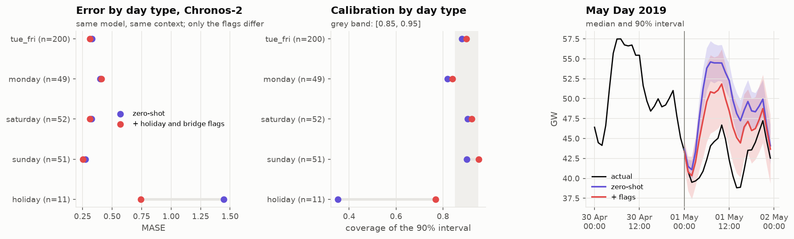

## Limits

- One series. Block 3 repeats the comparison on the other OPSD load series.
- No temperature: for national load it is a first-order driver, and a TSO's day-ahead forecast uses it. Apart
  from the exploratory section 9 (calendar flags), every model here is univariate.
- Contamination: no documented overlap between the Chronos corpora and French load (block 1). Bolt's corpus is
  not itemised, so it cannot be excluded.
- Origins at 00:00 UTC only: a day-ahead market forecast is issued around noon the day before (horizon 12-36 h).
- MSTL and ETS intervals are model-based, not refitted on errors. Their under-coverage is part of the result, not
  a defect of the harness.

## Reproduce

```bash
uv run w25 download            # OPSD 2020-10-06, sha256 checked
uv run w25 forecast            # 608 origins x 8 models (about 6 min; the TSFMs take seconds on a GPU)
uv run w25 backtest --stress   # the table above, then the verdicts
uv run w25 figures-data && uv run w25 figures-results && uv run w25 ablation && uv run w25 calendar
```
