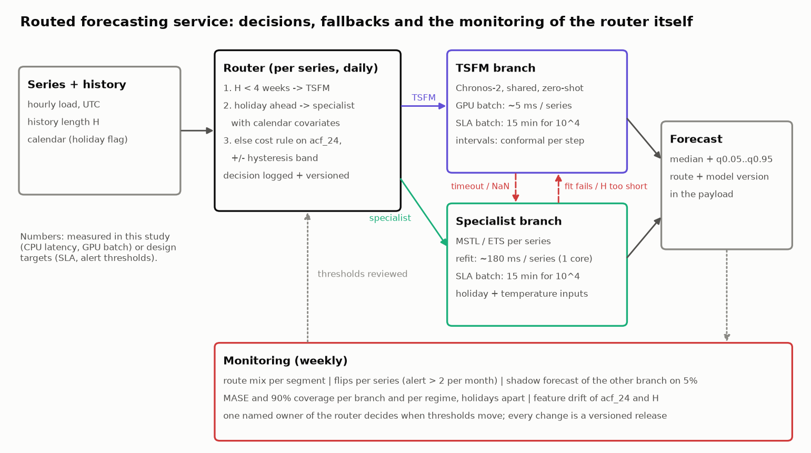
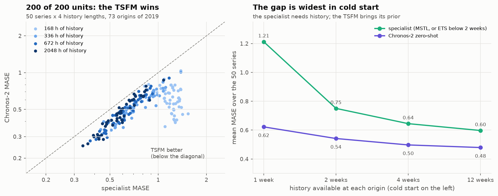
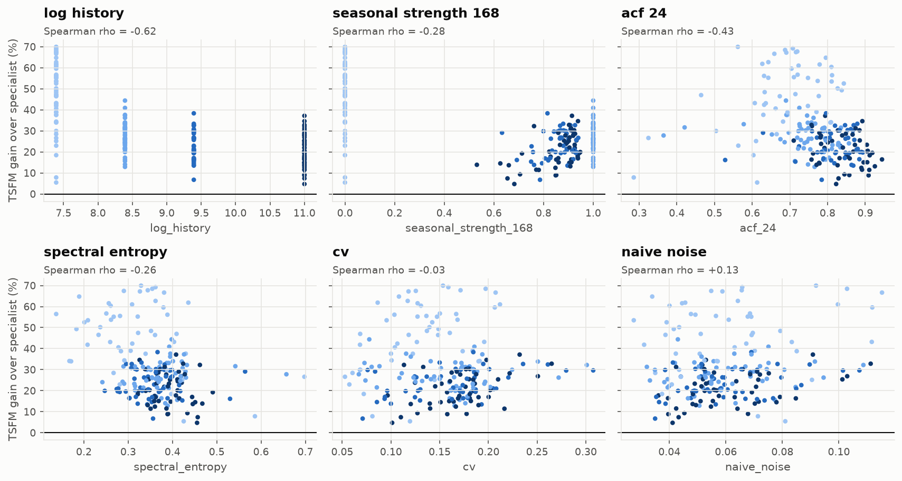
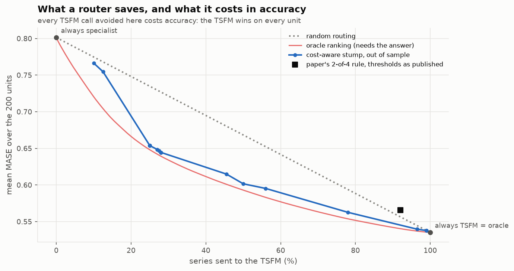
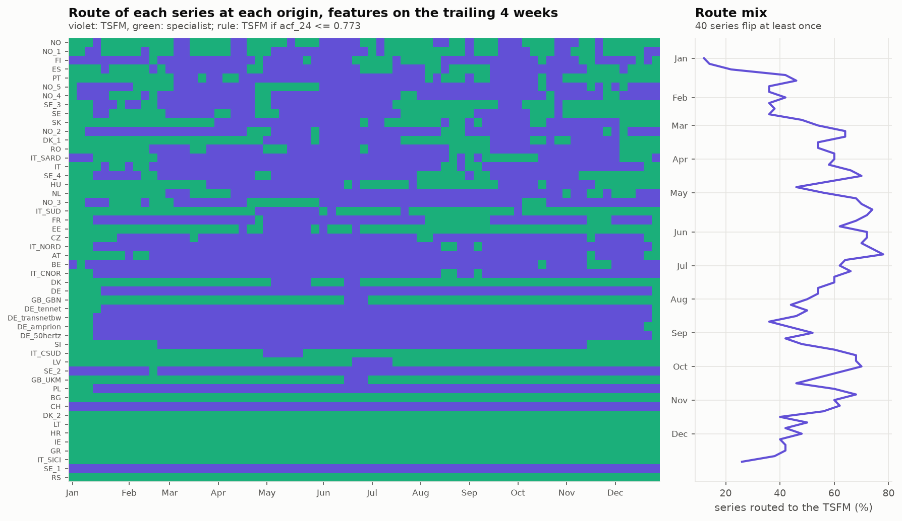

# Block 3: putting the Complexity Router into production

The plan asks for structured reasoning without code. It is given first below, in 12 lines. Every number in
it comes from the prototype that follows: the paper's router was rebuilt on 50 OPSD load series, under a
protocol committed before the results ([`configs/router.yaml`](../configs/router.yaml)), and evaluated out of
sample, one country left out at a time.

## The reasoning (the plan's deliverable)

1. **Routing feature that matters: the history length.** With 1 week of history, the TSFM's mean MASE is 0.62
   against 1.21 for the specialist. With 12 weeks it is 0.48 against 0.60. History length is the only feature
   whose rank correlation with the TSFM's gain is strong (rho = -0.62). Seasonal strength and ACF come next
   (-0.28, -0.43); the paper's CV and entropy say almost nothing here (-0.03, -0.26).
2. **Intermittency and physical constraints cannot be tested on national load**: the panel has neither.
   They stay candidate features for other portfolios and are not invented here.
3. **The threshold I can justify is "4 weeks of history"**: below it the specialist cannot see two weekly
   cycles and under-covers (0.62 coverage at 2 weeks). The paper's thresholds (entropy 0.24, CV 0.22...) do not
   transfer. Applied as published, they send 8% of series to the specialist and lose 0.030 MASE [0.014, 0.056].
4. **Accuracy vs cost: on load, the TSFM wins on 200 of 200 units** (gain 5% to 70%). A router can only buy
   cost savings with accuracy: 22% fewer TSFM calls cost 5% of MASE, 44% fewer cost 11%.
5. **And the cost premise is not true here.** Chronos-2 takes about 95 ms per series on 4 CPU threads, or about
   5 ms in a GPU batch. An MSTL refit takes 183 ms on one core. The paper's "an FM call costs 1000 specialist calls"
   holds for a specialist that only predicts; it does not hold for one that is refitted at each forecast.
6. **Contract:** both branches in **daily batch** (day-ahead), SLA 15 min for 10^4 series. Real time only for
   intraday re-forecasts, on the TSFM branch (no refit). The specialist is reserved for **days a calendar flag
   predicts** (holidays, block 2: the TSFM covers 37% of hours there), once it is given that flag.
7. **Fallback:** TSFM timeout or NaN, then the specialist. Specialist fit failure or H < 2 days, then the TSFM.
   Both failing: SeasonalNaive(24) plus a flag in the payload. Every forecast carries its route and its model version.
8. **The senior trap, measured:** with features on the trailing 4 weeks, a cost-aware rule on acf_24 changes the
   route of 40 of 50 series during 2019 (323 flips; the share sent to the TSFM swings from 12% to 78%), in step with
   holidays and seasons. Each flip changes the forecast's model overnight.
9. **Monitoring the router itself:** route mix per segment, flips per series (alert above 2 per month), a
   ±0.05 hysteresis band on the threshold (323 flips become 78), and a shadow forecast of the other branch on
   5% of series, so that the router's error is measured and not assumed.
10. **Train/serve skew of the router:** features computed on 12 weeks and thresholds applied to 4-week
    features do not match. Spectral entropy depends on the window. Fit and serve on the same window.
11. **Who arbitrates:** one named owner of the router. A threshold change is a versioned release, evaluated
    out of sample like a model, never a hot fix.
12. **Verdict for this portfolio:** default to the TSFM, route to the specialist on known calendar events and as
    the fallback, and do not deploy a complexity router whose only gain is a cost that the measurement does not show.



## The prototype

**Panel.** There are 50 load series (countries and bidding zones) with less than 0.5% missing hours in 2015-2019,
and 73 origins in 2019, one every 5 days so that every weekday appears. The horizon is 24 h. **Cold start** is
simulated by letting each model read only the last 1, 2, 4 or 12 weeks at every origin. That gives 200 units
(series x history).
**Branches.** The TSFM is Chronos-2 zero-shot, shared across series. The specialist is MSTL [24, 168]
refitted at each origin (ETS(Z,Z,A) when less than 2 weeks of history is available).



### Pre-registered policies (as written)

| policy | mean MASE | 90% coverage | sent to TSFM | MASE vs always-TSFM [95% CI, countries resampled] |
|---|---|---|---|---|
| always specialist | 0.801 | 0.745 | 0% | +0.266 [0.243, 0.296] |
| always TSFM | **0.535** | 0.846 | 100% | 0 |
| paper's rule (thresholds as published) | 0.566 | 0.833 | 92% | +0.030 [0.014, 0.056] |
| learned stump (leave one country out) | 0.535 | 0.846 | 100% | 0 |
| oracle (per-unit winner, needs the answer) | 0.535 | 0.846 | 100% | 0 |

The learned stump finds no split that improves on "always TSFM" in any of the 28 folds. With no unit where the
specialist wins, the oracle *is* "always TSFM".

| history | specialist MASE | TSFM MASE | specialist cov90 | TSFM cov90 |
|---|---|---|---|---|
| 1 week | 1.212 | 0.622 | 0.737 | 0.847 |
| 2 weeks | 0.751 | 0.542 | 0.615 | 0.838 |
| 4 weeks | 0.645 | 0.497 | 0.779 | 0.847 |
| 12 weeks | 0.597 | 0.479 | 0.849 | 0.850 |

### Which features predict the TSFM's gain



### Extension, not pre-registered: what a cost-aware router buys

The stump is charged a penalty per series it sends to the TSFM, in MASE units, and refitted leave-one-country-out
for each penalty. The result is the paper's Pareto curve, but out of sample and on load. The oracle curve sorts
units by their realised gain, which needs the answer.



The paper's rule sits **above the random-routing line** at its operating point (92% TSFM): on this panel it
routes worse than chance (random routing at 92%: 0.556). Out of sample, the cost-aware stump stays within 0.015 MASE
of the oracle between 25% and 100% of TSFM calls; below 15% the gap opens (0.05).

### The route over time



The stump is fitted on the 4-week features with the penalty whose out-of-sample share of TSFM calls is closest
to 2/3, the operating point of the paper's deployed router. Re-evaluated at every origin on the trailing 4
weeks, it moves 40 series at least once. The German zones switch together at the turn of the year, and the
British and Danish series in June. A router is a model, and its decision drifts like one.

| hysteresis band on acf_24 | flips in 2019 | series that flip | max flips for one series |
|---|---|---|---|
| none | 323 | 40 | 22 |
| ±0.01 | 218 | 38 | 16 |
| ±0.02 | 168 | 38 | 16 |
| ±0.05 | 78 | 35 | 6 |

## Limits

- The specialist is univariate and statistical. The paper's specialists are supervised models (XGBoost,
  PatchTST...), and a load specialist in production would have temperature and calendar inputs. A specialist
  with a holiday flag is the obvious next test, and the one most likely to reverse a unit (block 2, holidays).
- 73 origins per unit. Coverage figures are means over hours and are not conditional on regime.
- The cost figures are from one machine (RTX 5070 laptop GPU, 32-thread CPU). The ratio, not the absolute
  milliseconds, is what transfers.
- Chronos-2 has not been shown to have seen these series. fev-bench, however, evaluates it on OPSD load of AT, BE,
  DE, HU, LU and NL (block 1).

## Reproduce

```bash
uv run w25 router          # both branches x 4 histories on 50 series, policies, frontier, drift (a few minutes on GPU + 32 threads)
```
