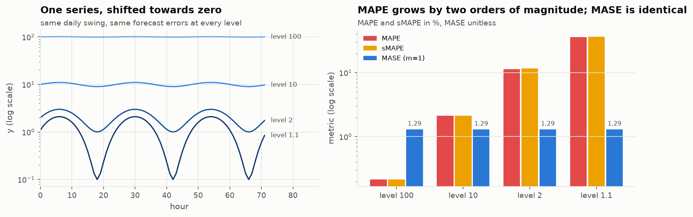
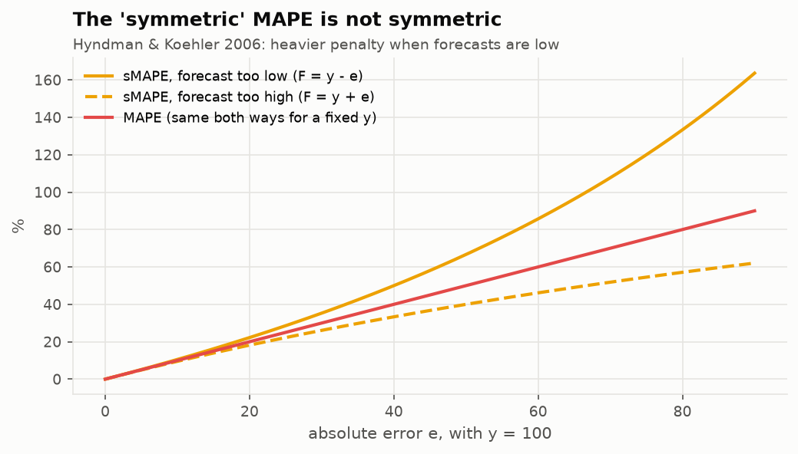
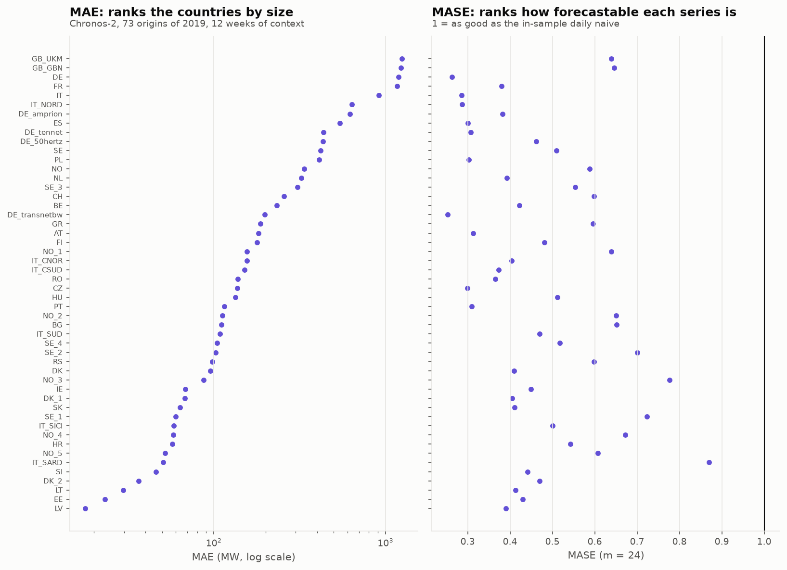
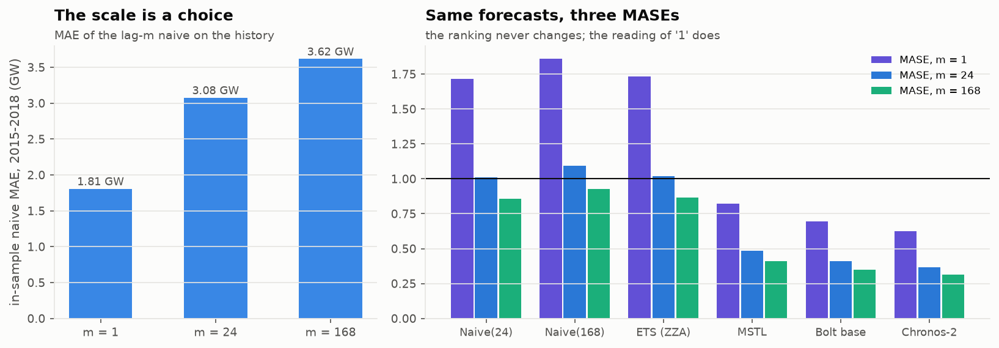

# Block 4: reference reading, the MASE

Hyndman & Koehler, *Another look at measures of forecast accuracy*, IJF 22(4), 2006
([preprint](https://robjhyndman.com/papers/mase.pdf)), and FPP3 section 5.8
([Evaluating point forecast accuracy](https://otexts.com/fpp3/accuracy.html)). The plan asks what to take from the paper: why
the MASE is scale-free and robust where the MAPE explodes. Each argument is shown below on a figure, then
connected to how the MASE is used in block 2.

## What the paper defines, and what it does not

- **MASE** = mean of |e_t| / Q, where Q is the in-sample MAE of the **one-step naive** (random walk) on the
  training data. A value below 1 means "better, on average, than the one-step naive was in-sample".
- The paper mentions that a multi-step naive can be used for multi-step forecasts, but it **does not define the
  seasonal (lag-m) version**. That version is FPP3 section 5.8: Q = mean |y_t - y_{t-m}| over the history.
  This study uses m = 24, as the plan asks; cite FPP3 for it.
- The only failure case is a constant history (Q = 0).

## Why not MAPE, and why not sMAPE

The MAPE divides each error by y_t. On a series that approaches zero, the same errors give a MAPE two orders of
magnitude larger; at y_t = 0 it is undefined. The MASE divides by an in-sample error of the same series, so it
does not see the level at all: 1.29 at every level above. The paper also notes that a percentage needs a
**meaningful zero**, which temperatures in °C, for instance, do not have.

The sMAPE was proposed to fix the MAPE and is not symmetric either. The paper says that for the same y_t it
"has a heavier penalty when forecasts are low compared to when forecasts are high". With y = 100, an error of 60
costs 86% if the forecast is low and 46% if it is high. A model that over-forecasts looks better.

**For this study:** French load never approaches zero (minimum about 29 GW), so MAPE would be usable here. The
argument for the MASE in blocks 2 and 3 is comparability **across** series (next figure), not robustness near zero.
The sMAPE in our tables is utilsforecast's, |e| / (|y| + |f|), half the textbook value. It is reported because the
plan asks for it, not used for any decision.

## Scale-free: what it buys on 50 load series

The MAE of the same model (Chronos-2, 12 weeks of context) on the 50 series of block 3 spans a factor 70,
from 18 MW (Latvia) to 1,245 MW (Great Britain, UKM), and mostly ranks the countries by size. Its MASE goes from
0.25 to 0.87. The MASE ranks them by how forecastable they are. Averaging MAE over the panel would
mean averaging Germany. Averaging MASE is what makes the router of block 3 possible.

## The scale is a choice, and it changes the meaning of "1"

Same forecasts of the French test year, three scales computed on 2015-2018:

| | m = 1 | m = 24 | m = 168 |
|---|---|---|---|
| in-sample naive MAE | 1.81 GW | 3.08 GW | 3.62 GW |
| SeasonalNaive(24) | 1.72 | 1.01 | 0.86 |
| MSTL | 0.82 | 0.48 | 0.41 |
| Chronos-2 | 0.63 | 0.37 | 0.31 |

- **The ranking never changes**, since one series has one scale. Across series, the scale changes the weights
  of a mean.
- **"Below 1" changes meaning.** With m = 24, SeasonalNaive(24) scores 1.01, almost exactly 1, which is the
  expected value: out of sample it repeats the in-sample method that defines the scale. With m = 1 the same
  forecasts score 1.72, because a 24-step forecast is compared with a one-step error. "MASE < 1" with m = 1 at a
  24-hour horizon is a much harder bar than it reads.
- In block 2 the scale is recomputed at every origin on the whole history up to that origin (utilsforecast
  `mase`, with the training frame cut at each cutoff). Over 2019 it moves by 2.0% (3.07 to 3.13 GW), so the mean over origins
  is not distorted by a moving denominator.

## Takeaways for a client deliverable

1. Report MASE (with m stated) for decisions, MAE in MW for the business, never MAPE on a series that can reach
   zero, and never sMAPE alone.
2. A MASE averaged over series is only as meaningful as the scale is comparable: same m, same history length.
3. A point metric says nothing about the intervals. Block 2 needs coverage **and** width (Winkler) for that:
   the flat AutoETS is the best-calibrated model of the table and the least useful one.
