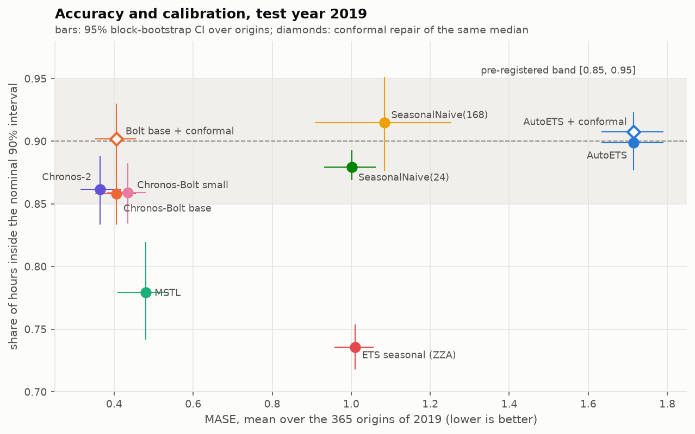

# W25: when does a zero-shot TSFM beat a refitted specialist?

Weekly study (ISO week 25, 2026) on the operational viability of time series foundation models. The question is
when a zero-shot model beats a specialist refitted on each series, and how to route between the two in
production. The original plan, in French, is [`plan_w25.md`](plan_w25.md). The decisions taken before writing
code are in [`SPEC.md`](SPEC.md), and the deviations and corrections in
[`IMPLEMENTATION_NOTES.md`](IMPLEMENTATION_NOTES.md).

**Report (figures, step by step):** [`docs/`](docs/index.html), rendered with Quarto from [`report/`](report/).

## The answer in one sentence (block 2)

> On French hourly load in 2019, Chronos-Bolt base beats AutoETS at every horizon step and on every ordinary day
> type: MASE ratio 0.24 [0.20, 0.27], or 0.40 against an ETS with forced seasonality, and its 90% coverage is
> 0.86. That "90%" interval is its 80% one by construction. It under-covers on h 13-18 (0.79). On the 11 public
> holidays it is no better than the seasonal ETS (ratio 1.12, CI 0.85-1.55) and covers 37% of the hours:
> zero-shot, it does not know the calendar.
>
> Told the calendar (a holiday flag as a known covariate, exploratory), Chronos-2 halves its holiday error and
> its 90% coverage over the year becomes 0.899.



## What changes relative to the plan

| Plan or source claim | What the checks say | Block |
|---|---|---|
| Baseline `SeasonalNaive` with season 24 | Kept, with the weekly naive next to it. I expected it to be a strawman; it beats the weekly naive on 5 weekdays out of 7 | [2](02_backtest_harness/README.md) |
| `AutoETS` as the reference | statsforecast selects ETS(A,N,N) by AICc (a one-step criterion) at 572 of 608 origins: a flat 24-h forecast. The verdict against it is reported as pre-registered, and again against an ETS with forced seasonality (declared deviation) | [2](02_backtest_harness/README.md) |
| "Use the TSFM's quantiles" for a 90% interval | Chronos-Bolt is trained on 0.1-0.9: asked for 0.05/0.95 it returns its 80% interval (cov80 = cov90 = 0.858). Chronos-2 is trained on 0.01-0.99. A conformal repair gives 0.902 | [2](02_backtest_harness/README.md) |
| "If the TSFM wins on MASE but covers 70%, say it" | It wins on MASE and covers 0.86 overall, but 0.79 on h 13-18 and 0.37 on public holidays. The flat AutoETS covers 0.899: coverage alone rewards a useless interval | [2](02_backtest_harness/README.md) |
| Zero-shot, the TSFM does not know the calendar (my block 2 sentence) | It can be told: with a holiday flag as a known covariate (exploratory), Chronos-2's holiday error halves (0.52 [0.39, 0.67]) and its yearly 90% coverage reaches 0.899 | [2](02_backtest_harness/README.md) |
| ">= 6 origins" | 365 daily origins. With 6, 24% of random draws reverse the Bolt vs MSTL ranking | [2](02_backtest_harness/README.md) |
| Foundation models excel in cold start (paper) | Confirmed on 50 load series: MASE 0.62 vs 1.21 with one week of history | [3](03_complexity_router/README.md) |
| The Complexity Router gives better accuracy at much lower cost (paper) | The headline is an oracle ranking; the deployed rule (paper's repo) saves 33%. Here the TSFM wins on all 200 units, the paper's thresholds lose 0.030 MASE out of sample, and a router can only trade accuracy for cost | [1](01_tech_watch/README.md), [3](03_complexity_router/README.md) |
| An FM call costs 1000x a specialist (paper's assumption) | Chronos-2: 95 ms per series on 4 CPU threads, about 5 ms in a GPU batch; MSTL refit: 183 ms on one core | [3](03_complexity_router/README.md) |
| "Monitor the drift of the routing decision" | Measured: 40 of 50 series change branch over 2019 with a 4-week feature window; a ±0.05 hysteresis band cuts flips from 323 to 78 | [3](03_complexity_router/README.md) |
| GIFT-Eval leader at 18.5M parameters | True on 12 April 2026 only under two filters; #13 in October 2026 | [1](01_tech_watch/README.md) |
| MASE from Hyndman & Koehler (2006), seasonal | The paper defines the lag-1 version; the lag-m one is FPP3 section 5.8 | [4](04_reference_reading/README.md) |

## Blocks

| Block | Folder | Command | Deliverable |
|---|---|---|---|
| 1 Watch | [`01_tech_watch`](01_tech_watch/README.md) | `w25 figures-misc` | the three resources read at the source, contamination and licences |
| 2 Engineering | [`02_backtest_harness`](02_backtest_harness/README.md) | `w25 forecast`, `w25 backtest` | rolling-origin harness, metrics x models table, verdict by regime and horizon |
| 3 System design | [`03_complexity_router`](03_complexity_router/README.md) | `w25 router` | the reasoning in 12 lines, and the router rebuilt on 50 series, out of sample |
| 4 Reading | [`04_reference_reading`](04_reference_reading/README.md) | `w25 figures-misc` | the MASE paper on figures, and on our results |

## Reproduce

```bash
uv sync                      # Python 3.11, versions pinned in uv.lock
uv run pytest                # fast tests; uv run pytest -m slow runs the real Chronos weights on CPU
make all                     # data, forecasts, tables, figures, router, report (GPU optional)
```

The OPSD file (version 2020-10-06) is checked against the sha256 written in `configs/protocol.yaml`.
Forecasts are deterministic: two GPU runs are bit-identical, and CPU and GPU differ by at most 0.016 MW.
